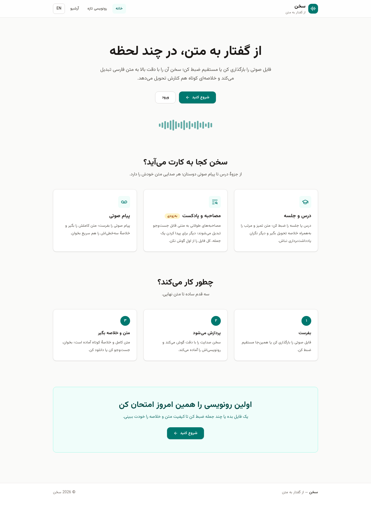
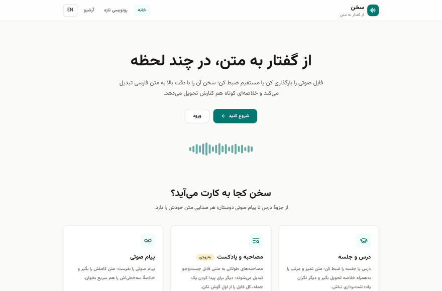
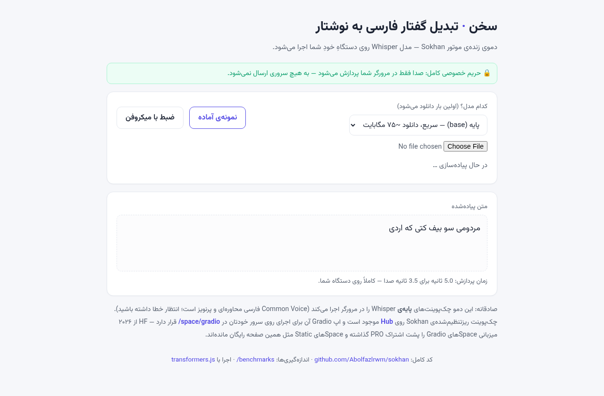
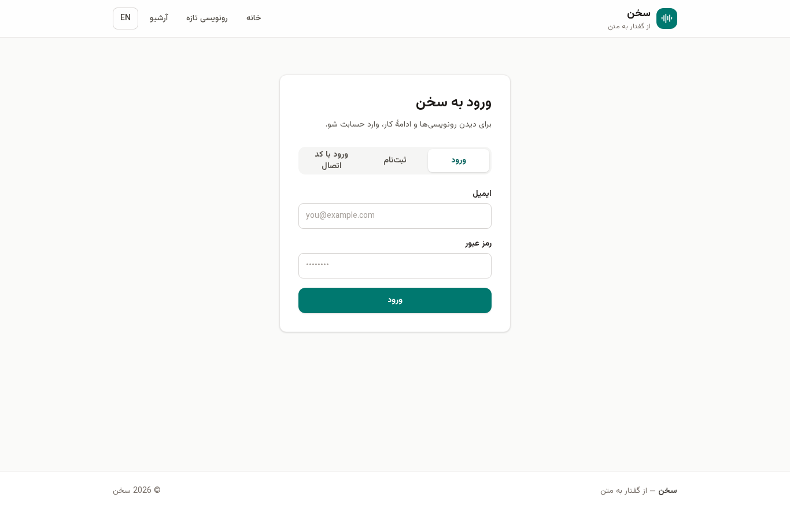
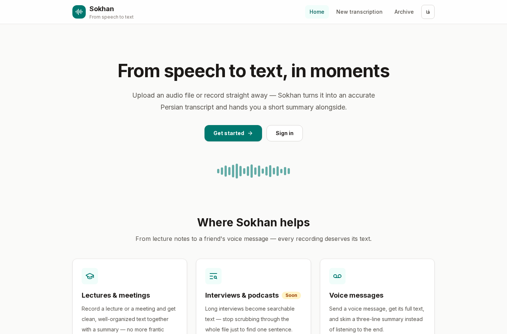

# سخن · Sokhan

**فارسی** | [English](README.md)

<div align="center">
  
</div>

[](https://github.com/Abolfazlrwm/sokhan/actions/workflows/ci.yml)
[](https://github.com/Abolfazlrwm/sokhan/actions/workflows/codeql.yml)
[](https://github.com/Abolfazlrwm/sokhan/actions/workflows/docker.yml)
[](https://github.com/Abolfazlrwm/sokhan/actions/workflows/benchmark.yml)
[](https://github.com/Abolfazlrwm/sokhan/actions/workflows/sync-space.yml)
[](https://github.com/Abolfazlrwm/sokhan/releases)
[](https://api.securityscorecards.dev/projects/github.com/Abolfazlrwm/sokhan)
[](https://abolfazlrwm.github.io/sokhan/)
[](LICENSE)

**کیت گفتار به متنِ فارسی‌محور.** یک پیام صوتی بفرستید — متنِ کامل و خلاصه تحویل بگیرید.

**اول در مرورگر امتحانش کنید:** دموی عمومی در
[hf.co/spaces/Abol0pati/sokhan-fa-demo](https://huggingface.co/spaces/Abol0pati/sokhan-fa-demo)
مدل Whisper را کاملاً سمتِ مرورگر اجرا می‌کند (transformers.js، ONNX q8) —
ضبط با میکروفون یا آپلود فایل، انتخاب بین مدل base/small، بدون هیچ نصبی و
بدون آپلود شدنِ هیچ صدایی. چک‌پوینتِ **فاین‌تیون‌شده** هم به‌صورت اپ Gradio
قابل سلف‌هاست منتشر شده ([space/gradio/](space/gradio/))؛ قیمت‌گذاری ۲۰۲۶
هاگینگ‌فیس، Spaceهای Gradio را پشت اشتراک PRO قفل کرده، برای همین Space
رایگان همان صفحهٔ استاتیک است. یک **لندینگ‌پیج** یک‌صفحه‌ای با عددهای
اندازه‌گیری‌شده هم در
[abolfazlrwm.github.io/sokhan](https://abolfazlrwm.github.io/sokhan/)
(به‌طور خودکار از [`site/`](site/) دیپلوی می‌شود) در دسترس است.

سخن کاملاً روی سخت‌افزار خودتان اجرا می‌شود: یک سرویس FastAPI با موتور
faster-whisper، یک ورکر Celery، یک داشبورد Next.js که فارسی‌محور نوشته
شده (راست‌به‌چپ)، و یک ربات تلگرام اختیاری. بدون حساب ابری، بدون قیمتِ
هر دقیقه. متن‌بازِ‌قابل‌مطالعه: برای استفاده غیرتجاری رایگان، برای استفاده تجاری لایسنس تجاری (بخش [لایسنس](#لایسنس)).



یک اجرای واقعی سر‌به‌سر — یک کلیپ صوتی فارسی آپلود کنید، پیشرفت زنده را
ببینید، متن را تحویل بگیرید (ضبط‌شده روی خودِ اپ واقعی، بدون ماکاپ):



همان دموی Space، بعد از رونویسی یک کلیپ واقعی Common Voice (فارسی) در
مرورگر بدون سر (کلیپ ۳.۵ ثانیه‌ای، ۵.۰ ثانیه روی دستگاه):



اگر سخن برایتان مفید بود، زدن ستاره در گیت‌هاب به دیگر فارسی‌زبان‌ها کمک
می‌کند پروژه را پیدا کنند.

## چرا

اکثر ابزارهای گفتار به متن، فارسی را یک فکرِ بعدی حساب می‌کنند. سخن از
اولین کامیت برای فارسی‌زبان‌ها ساخته شده است:

- رابط کاربری اول فارسی است و انگلیسی لوکال دوم (راست‌به‌چپ به‌صورت پیش‌فرض)
- جست‌وجوی آرشیو شبیه‌نویسی‌های عربی را نرمال می‌کند (ي→ی، ك→ک) تا متنی که
  با هر چیدمان کیبورد تایپ شده پیدا شود
- خلاصه‌سازی LLM با پرامپت فارسی انجام می‌شود
- همه‌چیز با یک دستور `docker compose` سلف‌هاست می‌شود

## برای چه کسانی

- **دانشجوها** — از کلاس ضبط بگیرید، متن تمیز و یک خلاصه تحویل بگیرید
- **روزنامه‌نگارها و پادکسترها** — مصاحبه‌های طولانی به متنِ قابل جست‌وجو
- **همه** — ویسِ طولانی بفرستید، متن و یک خلاصهٔ کوتاه بگیرید

## امکانات

- **موتور رونویسی** — صدا با PyAV بلاک‌به‌بلاک از دیسک خوانده می‌شود (بدون
  ffmpeg بیرونی؛ `STREAMING_DECODE`، به‌صورت پیش‌فرض روشن)، به پنجره‌های
  ۳۰ ثانیه‌ای با هم‌پوشانی ۱ ثانیه شکسته می‌شود، با faster-whisper روی CPU
  (int8) رونویسی و دوباره یکی می‌شود: تکرارهای مرز پنجره‌ها حذف و
  تایم‌استمپ‌ها به طول فایل محدود می‌شوند. حافظهٔ مصرفی با بلند شدن ضبط
  بالا نمی‌رود — اندازه‌گیری‌شده ۸۶.۴ مگابایت در برابر ۳۵۵.۶ مگابایت برای
  یک فایل ۳۰ دقیقه‌ای (۴.۱ برابر کمتر)
- **بازنشانی نشانه‌گذاری فارسی** — یک پس‌پردازش قاعده‌محور و قطعی (v1.4)
  جریان خام کلمه‌های Whisper را به متنِ آمادهٔ انتشار تبدیل می‌کند: علامت
  سؤال فارسی روی جمله‌های پرسشی، نقطه در بقیه، نگاشت علائم لاتین به ،/؛/؟،
  اصلاح فاصله‌ها اطراف هر علامت، اعشار و ساعت دست‌نخورده
  (`PUNCTUATION_ENABLED`، به‌صورت پیش‌فرض روشن)
- **خروجی‌ها** — TXT، SRT، WebVTT (همه با تایم‌کد دقیق)، JSON ساختاریافته
  و DOCX؛ داشبورد هم تایم‌لاین سگمنت‌به‌سگمنت با برچسب گوینده و دکمهٔ کپی
  را نشان می‌دهد
- **پرچم بازبینی با اطمینان مدل** — هر سگمنت اطمینانِ `exp(avg_logprob)`
  خودِ مدل را حمل می‌کند؛ بازه‌های زیر `LOW_CONFIDENCE_THRESHOLD` در
  خروجی‌های SRT/VTT/DOCX با «⚠» و در تایم‌لاین داشبورد با نشانِ «نیاز به
  بازبینی» علامت می‌خورند تا بازبین دقیقاً بداند کجا را دوباره بشنود
- **API سازگار با OpenAI** — `POST /v1/audio/transcriptions` با همان
  قرارداد multipart اوپن‌ای‌آی کار می‌کند (`json`، `text`، `srt`، `vtt`،
  `verbose_json`) تا ابزارهای موجود بدون تغییر کد به سرور خودتان اشاره کنند
- **وب‌هوک امضاشده** — هنگام ساخت کاری `callback_url` بدهید تا ورکر در پایان،
  رویداد موفقیت/شکست را با امضای HMAC به آن POST کند
  (`X-Sokhan-Signature: t=…,v1=…`) تا دریافت‌کننده بتواند مبدأ را تأیید کند؛
  یک بار تلاش مجدد و یک endpoint مرده هرگز وضعیت کار را خراب نمی‌کند
- **خط لولهٔ کاری** — آپلود، پایش پیشرفت، دانلود متن؛ Celery + Redis در
  محیط عملیاتی و تردهای درون‌فرآیندی (`CELERY_ENABLED=false`) وقتی اصلاً
  Redis نمی‌خواهید
- **پلن‌ها و سهمیه** — دو سطح آماده: **رایگان** (فایل حداکثر ۱۰ دقیقه‌ای،
  ۳۰ دقیقه در ماه) و **حرفه‌ای** (فایل تا ۱۸۰ دقیقه، ۱۲۰۰ دقیقه در ماه،
  تا وقتی اشتراک منقضی نشده). هر دو مسیر آپلود (`POST /jobs` و
  `POST /v1/audio/transcriptions`) کارِ بیش‌ازسقف را با HTTP 402 صادقانه
  رد می‌کنند (`quota_exceeded` / `file_too_long`)، مشترکِ منقضی‌شده خودکار
  به سقف‌های رایگان برمی‌گردد و اپراتور با
  `POST /admin/users/{email}/plan` اشتراک زمان‌دار صادر می‌کند (تمدیدها
  روی زمان باقی‌مانده سوار می‌شوند)
- **حسابداری سهمیه** — ردیف‌های مصرف هر کاربر سهمیهٔ ماهانه را می‌سازند؛
  سقف‌ها با متغیرهای محیطی `PLAN_*` قابل تنظیم‌اند
- **جست‌وجوی آرشیو** — جست‌وجوی تمام‌متنِ نرمال‌شدهٔ فارسی روی متن‌ها و
  نام فایل‌ها (pg_trgm روی Postgres، ILIKE در بقیه)
- **داشبورد وب** — لندینگ، ورود/ثبت‌نام + ورود کد اتصال، آپلود با ضبط
  درون‌مرورگری، پیشرفت زنده، آرشیوِ قابل جست‌وجو
- **ربات تلگرام** — پیام صوتی بفرستید، متن را تحویل بگیرید؛ `/quota`،
  `/upgrade` (کاتالوگ پلن‌ها)، `/track`، دکمهٔ خلاصه و کد اتصالی که حساب
  وب شما را به ربات وصل می‌کند؛ ویس‌های بلندتر از سقفِ پلن قبل از آپلود و
  با توضیح فارسی رد می‌شوند
- **خلاصه‌سازی (اختیاری)** — هر endpoint سازگار با OpenAI پشت
  `SUMMARY_ENABLED`؛ بدون کلید، بقیهٔ چیزها همچنان کار می‌کنند
- **جداسازی گوینده (اختیاری)** — `DIARIZATION_ENGINE=stub|energy|pyannote`:
  یک هیوریستیک انرژی بدون وابستگی برای هاست‌های فقط‌CPU، یا دیاوریزیشن
  عصبی واقعی با pyannote؛ برچسب گوینده به سگمنت‌ها و خروجی SRT می‌رسد
  ([ADR 0004](docs/adr/0004-diarization-engines.md))
- **کیت فاین‌تیون** — خط لولهٔ LoRA برای تطبیق Whisper با گفتار فارسی و
  سرو کردن نتیجه با faster-whisper؛ سر‌به‌سر و بدون GPU تأیید شده
  ([training/](training/README.md))، یک‌کلیکی روی GPU رایگان با
  [docs/free-gpu.md](docs/free-gpu.md)

## تصاویر

ورود، ثبت‌نام و ورود با کد اتصال (فارسی):



همان داشبورد در لوکال انگلیسی:



## شروع سریع (سلف‌هاست)

پیش‌نیاز: داکر با پلاگین compose. Whisper به‌صورت پیش‌فرض روی CPU اجرا
می‌شود — GPU لازم نیست.

```bash
git clone https://github.com/Abolfazlrwm/sokhan.git
cd sokhan
cp .env.example deploy/.env   # compose فایل .env کنار فایل compose را می‌خواند
# در deploy/.env مقدار POSTGRES_PASSWORD را یک رمز طولانی و تصادفی بگذارید
docker compose -f deploy/docker-compose.yml up -d --build
```

- داشبورد وب: http://localhost:3000
- API و مستندات: http://localhost:8000/docs

ورکر مدل Whisper تنظیم‌شده را در اولین رونویسی دانلود می‌کند
(`WHISPER_MODEL_SIZE`، پیش‌فرض `small`) و آن را روی ولوم `sokhan-data`
(`HF_HOME=/data/huggingface`) نگه می‌دارد، پس ساخت دوبارهٔ کانتینرها مدل را
دوباره دانلود نمی‌کند. برای فعال‌کردن خلاصه‌سازی،
`SUMMARY_ENABLED=true` و متغیرهای LLM خود را در فایل `.env` کنار
`docker-compose.yml` بگذارید. برای اعمال مهاجرت‌های اسکیما به‌صورت دستی:

```bash
docker compose -f deploy/docker-compose.yml run --rm api \
  alembic -c /app/alembic.ini upgrade head
```

(API خودش موقع استارت جدول‌ها را می‌سازد؛ Alembic برای ارتقاهاست.)

### ایمیج‌های از پیش ساخته‌شده (بدون build)

هر پوش به `main` و هر تگ نسخه، ایمیج‌ها را با ورک‌فلو `docker.yml` روی
GHCR منتشر می‌کند تا سلف‌هاست مجبور به کامپایل چیزی نباشد:

```bash
docker pull ghcr.io/abolfazlrwm/sokhan-api:latest
docker pull ghcr.io/abolfazlrwm/sokhan-web:latest
```

`deploy/docker-compose.yml` همین نام‌های ایمیج را کنار بلوک‌های `build:`
خودش نوشته: با `up -d --build` لوکال بسازید، یا با
`docker compose -f deploy/docker-compose.yml pull` و `up -d --no-build`
ایمیج‌های منتشرشده را اجرا کنید. نسخه‌های پین‌شده تابع تگ‌های گیت هستند
(مثل `ghcr.io/abolfazlrwm/sokhan-api:1.2.0`). توجه: ایمیج وب مقدار
`NEXT_PUBLIC_API_BASE` (پیش‌فرض `http://localhost:8000`) را موقع build
می‌گیرد — دیپلوی‌هایی که داشبورد را از origin دیگری سرو می‌کنند باید خودشان
این build argument را بدهند.

## توسعه

```bash
# بک‌اند (Python 3.10+؛ مجموعه تست‌ها GPU نمی‌خواهد)
pip install -e "backend[dev]" -e "bot[dev]"
pytest -m "not gpu_optional"          # تست‌های سریع؛ موتور فیک استفاده می‌شود
ruff check backend bot
mypy --config-file backend/pyproject.toml backend/sokhan

# وب (Node 20+)
cd web && npm install && npm run build

# اعتبارسنجی فایل compose
docker compose -f deploy/docker-compose.yml config -q
```

اجرای رونویسی با مدل واقعی به‌صورت لوکال (شبکه + espeak-ng لازم است):

```bash
SOKHAN_REAL_MODEL_TEST=1 pytest backend/tests/test_real_model.py
```

### پیکربندی

| متغیر | پیش‌فرض | توضیح |
| --- | --- | --- |
| `DATABASE_URL` | `sqlite:///./sokhan-dev.sqlite3` | در محیط عملیاتی Postgres |
| `REDIS_URL` | `redis://localhost:6379/0` | broker/backend سِلِری |
| `CELERY_ENABLED` | `true` | `false` یعنی کارها درون‌فرآیندی (بدون Redis) |
| `DATA_DIR` | `./data` | محل ذخیرهٔ صداهای آپلودشده |
| `WHISPER_MODEL_SIZE` | `small` | tiny/base/small/medium/large-v3 |
| `WHISPER_DEVICE` | `cpu` | یا `cuda` |
| `WHISPER_COMPUTE_TYPE` | `int8` | روی GPU: `float16` |
| `FREE_MINUTES_PER_USER_PER_MONTH` | `30` | سهمیهٔ ماهانهٔ پلن رایگان هر کاربر |
| `PLAN_FREE_MAX_FILE_MINUTES` | `10` | سقف طول فایل در پلن رایگان |
| `PLAN_PRO_MAX_FILE_MINUTES` | `180` | سقف طول فایل برای مشترکِ فعال حرفه‌ای |
| `PLAN_PRO_MONTHLY_MINUTES` | `1200` | سهمیهٔ ماهانهٔ مشترکِ فعال حرفه‌ای |
| `ADMIN_API_KEY` | خالی | رمز مشترک برای `POST /admin/users/{email}/plan`؛ خالی یعنی سطح ادمین غیرفعال |
| `MAX_UPLOAD_MB` | `200` | سقف حجم آپلود |
| `PUNCTUATION_ENABLED` | `true` | پس‌پردازش قاعده‌محور نشانه‌گذاری فارسی |
| `LOW_CONFIDENCE_THRESHOLD` | `0.5` | اطمینان سگمنت زیرِ این مقدار پرچم بازبینی می‌گیرد |
| `STREAMING_DECODE` | `true` | خواندن بلاک‌به‌بلاک صدا (حافظهٔ اوج ∝ پنجره، نه طول فایل) |
| `WEBHOOK_SIGNING_SECRET` | خالی | رمز HMAC برای کال‌بک‌های پایان کار (`X-Sokhan-Signature`)؛ خالی یعنی بدون امضا |
| `WEBHOOK_ALLOW_PRIVATE_TARGETS` | `false` | اجازهٔ کال‌بک به نشانی‌های خصوصی/لوکال (فقط برای نصب تک‌کاربرهٔ مورد اعتماد) |
| `LOGIN_MAX_FAILURES` / `LOGIN_FAILURE_WINDOW_SECONDS` | `10` / `900` | تعداد ورود ناموفق برای هر نشانی و ایمیل پیش از `429`؛ `0` یعنی غیرفعال |
| `SUMMARY_ENABLED` | `false` | فلگ امکان خلاصه‌سازی با LLM |
| `LLM_API_BASE` / `LLM_API_KEY` / `LLM_MODEL` | خالی | endpoint سازگار با OpenAI |
| `TELEGRAM_BOT_TOKEN` | خالی | فعال‌سازی فرایند ربات |
| `BOT_API_SECRET` | خالی | رمز مشترکی که ربات به `POST /auth/telegram` می‌فرستد؛ روی API و ربات یک مقدار بگذارید، خالی یعنی ورود تلگرامی غیرفعال |
| `WEB_BASE_URL` | `http://localhost:3000` | لینک‌هایی که ربات می‌فرستد |
| `API_BASE_URL` | `http://localhost:8000` | آدرس API که ربات صدا می‌زند |
| `NEXT_PUBLIC_API_BASE` | `http://localhost:8000` | آدرس API که اپ وب صدا می‌زند (زمان build) |

فهرست کامنت‌دار در [.env.example](.env.example).

## سطح API

| Endpoint | کارکرد |
| --- | --- |
| `POST /auth/register`، `POST /auth/login` | حساب‌های ایمیلی |
| `POST /auth/token-login`، `POST /auth/telegram` | کدهای اتصال / پیوند ربات |
| `POST /jobs` | آپلود صدا (`language`، `want_summary`، `callback_url` اختیاری) و ساخت کار در صف |
| `GET /jobs` / `GET /jobs/{id}` | فهرست، و جزئیات با پیشرفت + سگمنت‌ها |
| `GET /jobs/{id}/transcript?format=txt\|srt\|vtt\|json\|docx` | خروجی‌ها |
| `GET /jobs/{id}/summary` | خلاصهٔ LLM وقتی فعال است |
| `GET /search?q=…` | جست‌وجوی آرشیو با نرمال‌سازی فارسی |
| `GET /quota` | پلن، مصرف ماهانه و سقف طول فایل |
| `GET /plans` | کاتالوگ عمومی پلن‌ها (سقف‌های رایگان / حرفه‌ای) |
| `GET /admin/users/{email}` | اپراتور: پلن و تاریخ انقضای یک کاربر |
| `POST /admin/users/{email}/plan` | اپراتور: صدور اشتراک حرفه‌ای برای N روز (تمدیدها تجمیع می‌شوند) یا بازگشت به رایگان؛ هدر `X-Admin-Key` لازم است |
| `POST /v1/audio/transcriptions` | رونویسی سازگار با OpenAI |

## ساختار ریپازیتوری

```
backend/     سرویس FastAPI، موتور Whisper، خط لولهٔ ورکر، Alembic
web/         داشبورد Next.js (fa/en، راست‌به‌چپ‌محور)
bot/         ربات تلگرام با aiogram 3
benchmarks/  بنچمارک WER بازتولیدپذیر روی کلیپ‌های واقعی Common Voice (فارسی)
training/    خط لولهٔ فاین‌تیون Whisper فارسی (LoRA)
deploy/      docker-compose برای سلف‌هاست با یک دستور
docs/        یادداشت‌های معماری و سوابق تصمیم (ADR)
site/        لندینگ‌پیج GitHub Pages (دیپلوی خودکار)
```

## داده و حریم خصوصی

محصولی که با ضبط‌های صوتی سروکار دارد باید سیاستِ داده‌اش را صریح بنویسد،
نه ضمنی بگذارد:

- **سلف‌هاست یعنی دستگاه خودتان.** صدا در `DATA_DIR` همان سروری می‌نشیند که
  خودتان اجرا می‌کنید؛ متن‌ها و ردیف‌های مصرف در Postgres خودتان‌اند و حذف
  یک کار یعنی حذف واقعی فایل آن — هیچ تکراری به سرویس ثالثی نمی‌رود و هیچ
  تلفن‌خانه‌ای در کار نیست. Whisper کلاً لوکال اجرا می‌شود و در مسیر
  رونویسی هیچ API ابری وجود ندارد.
- **دموی مرورگری هیچ‌چیز آپلود نمی‌کند.** Space عمومی با transformers.js
  (ONNX، q8) داخل مرورگرِ بازدیدکننده اجرا می‌شود: هم وزن‌های مدل و هم صدا
  روی دستگاه خودِ او می‌مانند. تنها ترافیک شبکه، دانلود مدلِ عمومی از
  Hugging Face Hub است.
- **بدون تله‌متری.** بک‌اند صفر آنالیتیکس و صفر ردیابی دارد و هیچ تماس
  خروجی‌ای ندارد مگر قابلیت‌های اختیاری که خودتان پیکربندی کنید (مثل
  endpoint خلاصه‌سازی LLM).
- **سیاست نگهداری با اپراتور است.** شما تصمیم می‌گیرید `DATA_DIR` و
  کارهای قدیمی کِی پاک شوند؛ در اسکیمای دیتابیس هیچ کپی دیگری از صدا ذخیره
  نمی‌شود.

## وضعیت پروژه و محدودیت‌های صادقانه

- دقت: اندازه‌گیری‌شده روی نمونهٔ ثابت عمومی — ۱۲ کلیپ واقعی Common Voice
  (فارسی)، ۶۱ ثانیه صدا، مرجعِ تأییدشدهٔ انسانی. پشتهٔ دقت v2 (پرامپت ارتوگرافی
  فارسی + پست‌پروسس `fa_polish`، هر دو در [benchmarks/](benchmarks/README.md)
  اندازه‌گیری شده) فیکسچر را از **WER 80.5% به 75.0% روی `small`** می‌رساند و
  **موتور پیش‌فرض حالا `medium` است: WER 56.2% / CER 18.5%** با سرعت ~۱٫۱×
  بلادرنگ روی ۲ هستهٔ CPU (int8، دانلود ~۸۰۰ مگابایت؛ برای حالت سرعت‌محور
  `WHISPER_MODEL_SIZE=small` بگذارید). اولین فاین‌تیون GPU — LoRA روی
  `whisper-small`، ۵۰۰ کلیپ، T4 رایگان Colab — با همان هارنس v2 عدد
  **WER 75.0% / CER 31.0%** می‌گیرد
  ([Abol0pati/whisper-small-fa-sokhan](https://huggingface.co/Abol0pati/whisper-small-fa-sokhan)).
  این عددها همچنان به‌خاطر عامیانه و پرنویز بودن Common Voice فارسی بالاست؛
  گفتار بازخوانی خیلی ساده‌تر است. روش کامل و خروجیِ هر کلیپ:
  [benchmarks/README.md](benchmarks/README.md).
- برچسب گوینده به موتور دیاوریزیشنی که انتخاب می‌کنید وابسته است. `energy`
  یک هیوریستیک است: برچسب‌هایش شباهت صوتی را توصیف می‌کنند نه هویتِ تأییدشده
  را، و بعد از دو گوینده به مشکل می‌خورد. `pyannote` همان چیزِ واقعی است اما
  وزن‌های گیت‌شدهٔ HF به‌علاوهٔ توکن می‌خواهد (ببینید
  [ADR 0004](docs/adr/0004-diarization-engines.md)). با `stub` — پیش‌فرض —
  سگمنت‌ها برچسب گوینده ندارند.
- حافظه با طراحی محدود می‌شود: ورکر صدا را بلاک‌به‌بلاک می‌خواند
  (`STREAMING_DECODE`، پیش‌فرض روشن) به‌جای دیکدکردن کل فایل — یک ضبط
  ۳۰ دقیقه‌ای به اوج ۸۶.۴ مگابایت می‌رسد در برابر ۳۵۵.۶ مگابایت دیکد کامل
  (اندازه‌گیری‌شده روی WAVهای یکسان). موتورهای دیاوریزیشنی که به سیگنال کامل
  نیاز دارند (`energy`، `pyannote`) همچنان مسیر قدیمیِ دیکد کامل را می‌روند.

## نقشه راه

- ~~جداسازی واقعی گوینده پشت فلگ محیطی~~ — ارسال‌شده در v1.1.0
  (`DIARIZATION_ENGINE=energy|pyannote`، ببینید ADR 0004)
- فاین‌تیون Whisper فارسی — اولین اجرای **GPU-مقیاس** اندازه‌گیری و
  منتشر شد (v1.2.0): WER فیکسچر 80.5% → 79.3% فقط با ۵۰۰ کلیپ آموزش
  ([training/](training/README.md))؛ قدم بعدی همان نوت‌بوک با
  `MAX_SAMPLES = 0` است (مانیفست کامل ۱۰ ساعته، حدود ۲ ساعت روی T4 رایگان،
  [docs/free-gpu.md](docs/free-gpu.md))
- ~~دیکد جریانیِ chunk برای کاهش حافظهٔ ورکر در ضبط‌های طولانی~~ — ارسال‌شده
  در v1.3.0 (`STREAMING_DECODE`، پیش‌فرض روشن): حافظهٔ اوج برای ضبط‌های
  چندساعته محدود می‌ماند، اندازه‌گیری‌شده ۴.۱ برابر کمتر روی فایل ۳۰ دقیقه‌ای
- ~~پس‌پردازش بازنشانی نشانه‌گذاری فارسی~~ — ارسال‌شده: یک گذرِ قاعده‌محور و
  قطعی (`PUNCTUATION_ENABLED`)، بدون وابستگی به LLM؛ سگمنت‌ها هم اطمینان مدل
  را حمل می‌کنند با پرچم‌های بازبینی در خروجی‌ها و داشبورد
- ~~وب‌هوک/اعلان‌ها وقتی کار تمام می‌شود~~ — ارسال‌شده: اعلان اتمام ربات
  تلگرام (پایدار در برابر ری‌استارت) و وب‌هوک‌های امضاشدهٔ HTTP برای
  فراخوان‌های بیرونی (`callback_url` روی `POST /jobs`،
  `X-Sokhan-Signature`)، هر دو در v1.3.0

نقشهٔ راه نسخه‌بندی‌شده با معیارهای پذیرش (و قاعدهٔ «اول اندازه‌گیری» که
همه‌چیز به آن مقید است): [docs/ROADMAP.md](docs/ROADMAP.md).

## لایسنس

سخن با لایسنس [PolyForm Noncommercial 1.0.0](https://polyformproject.org/licenses/noncommercial/1.0.0)
منتشر می‌شود (متن کامل در [LICENSE](LICENSE)): خواندن، بررسی و ارزیابیِ کد
آزاد است و **استفادهٔ غیرتجاری** (پروژهٔ شخصی، مطالعه، پژوهش، سازمان‌های
غیرانتفاعی) رایگان. **هر استفادهٔ تجاری** — اجرا برای کسب‌وکار، پروژهٔ
مشتری، فروش، یا ارائه به‌عنوان سرویس — به لایسنس تجاریِ پولی از نویسنده
نیاز دارد: [ابوالفضل رنجبران](https://github.com/Abolfazlrwm).

نسخه‌های تا و شامل v1.4.1 (۲۰۲۶-۱۱-۲۶) تحت لایسنس MIT منتشر شده بودند و
تحت همان لایسنس باقی می‌مانند.
