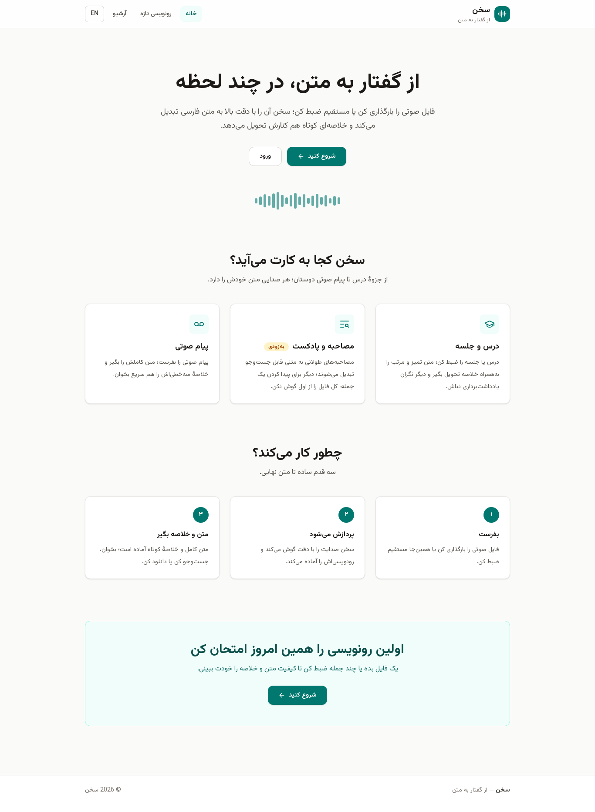
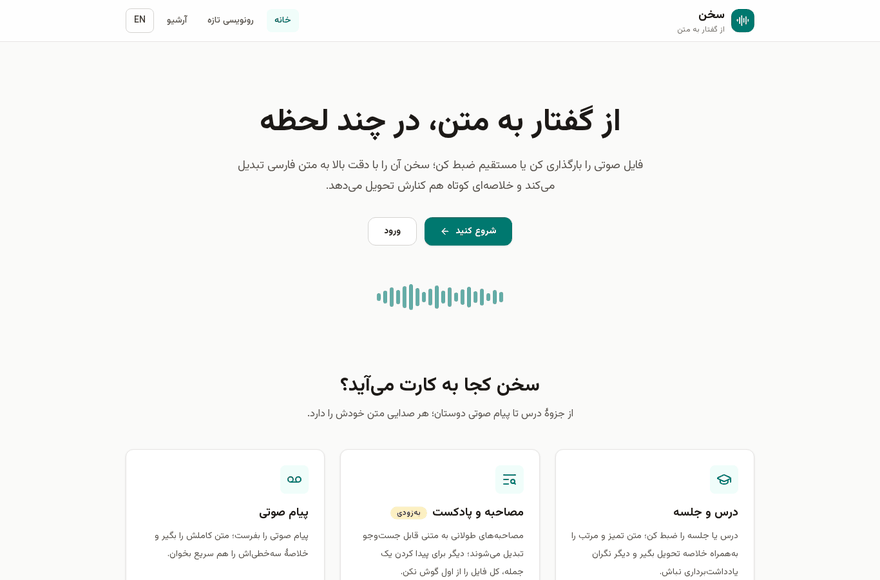
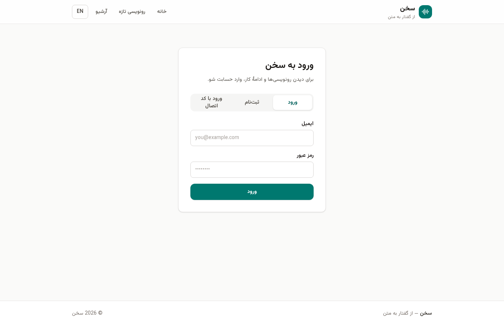
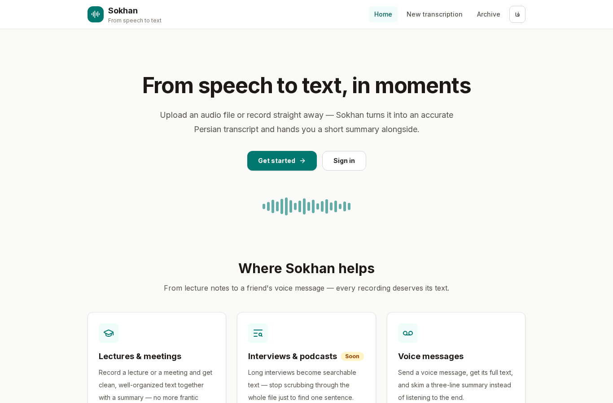

# Sokhan · سخن

[](https://github.com/Abolfazlrwm/sokhan/actions/workflows/ci.yml)

**Persian-first speech-to-text toolkit.** Send a voice message — get back a transcript and a summary.

Sokhan runs entirely on your own hardware: a FastAPI service with a
faster-whisper engine, a Celery worker, a Next.js dashboard written
Persian-first (RTL), and an optional Telegram bot. No cloud account, no
per-minute pricing, MIT-licensed.



Real end-to-end run — upload a Persian voice clip, watch the live progress,
get the transcript (recorded against the actual app, no mockups):



## Why

Most speech-to-text tooling treats Persian as an afterthought. Sokhan is
built for Persian speakers from the first commit:

- Persian UI first, English as a secondary locale (RTL by default)
- Archive search normalizes Arabic look-alikes (ي→ی, ك→ك) so text typed on
  any keyboard layout matches
- LLM summaries are prompted in Persian
- Everything is self-hostable with one `docker compose` command

## Who it is for

- **Students** — record a lecture, get clean text plus a summary
- **Journalists and podcasters** — turn long interviews into searchable text
- **Everyone** — send a long voice message, get the text and a short summary

## Features

- **Transcription engine** — audio is decoded with PyAV (no external ffmpeg),
  split into 30-second windows with a 1-second overlap, transcribed with
  faster-whisper on CPU (int8), and merged: boundary duplicates are dropped,
  timestamps are clamped to the file duration
- **Exports** — TXT, SRT (with accurate timecodes) and DOCX
- **OpenAI-compatible API** — `POST /v1/audio/transcriptions` works with the
  same multipart contract as the OpenAI API (`json`, `text`, `srt`,
  `verbose_json`), so existing tooling can point at your own instance
- **Job pipeline** — upload, progress polling, transcript downloads; Celery +
  Redis in production, inline threads (`CELERY_ENABLED=false`) when you don't
  want Redis at all
- **Quota** — `FREE_MINUTES_PER_USER_PER_MONTH` (default 30) enforced per
  user with an honest HTTP 402 once the limit is reached
- **Archive search** — Persian-normalized full-text search over transcripts
  and filenames (pg_trgm on Postgres, ILIKE elsewhere)
- **Web dashboard** — landing, login/registration + connect-code entry,
  upload with in-browser recording, live progress, searchable archive
- **Telegram bot** — send a voice message, receive the transcript; `/quota`,
  `/track`, summary button, and a connect code that links your web account
- **Summaries (optional)** — any OpenAI-compatible LLM endpoint behind
  `SUMMARY_ENABLED`; without a key everything else keeps working
- **Speaker diarization (optional)** — `DIARIZATION_ENGINE=stub|energy|pyannote`:
  a dependency-free energy heuristic for CPU-only hosts, or real neural
  diarization via pyannote; speaker labels flow into segments and the SRT
  export (see [ADR 0004](docs/adr/0004-diarization-engines.md))
- **Fine-tuning kit** — LoRA pipeline to adapt Whisper to Persian speech and
  serve the result with faster-whisper; verified end-to-end without a GPU
  ([training/](training/README.md)), one-click on free GPUs via
  [docs/free-gpu.md](docs/free-gpu.md)

## Screenshots

Login, registration and connect-code entry (Persian):



The same dashboard in the English locale:



## Quickstart (self-hosting)

Prerequisites: Docker with the compose plugin. Whisper runs on CPU by
default — a GPU is not required.

```bash
git clone https://github.com/Abolfazlrwm/sokhan.git
cd sokhan
docker compose -f deploy/docker-compose.yml up -d --build
```

- Web dashboard: http://localhost:3000
- API and docs: http://localhost:8000/docs

The worker downloads the configured Whisper model on first transcription
(`WHISPER_MODEL_SIZE`, default `small`). To enable summaries, set
`SUMMARY_ENABLED=true` and your LLM variables in a `.env` file next to
`docker-compose.yml`. To apply schema migrations manually:

```bash
docker compose -f deploy/docker-compose.yml run --rm api \
  alembic -c /app/alembic.ini upgrade head
```

(The API also creates tables on startup; Alembic is there for upgrades.)

## Development

```bash
# Backend (Python 3.10+, no GPU needed for the test suite)
pip install -e "backend[dev]" -e "bot[dev]"
pytest -m "not gpu_optional"          # fast tests; the fake engine is used
ruff check backend bot
mypy --config-file backend/pyproject.toml backend/sokhan

# Web (Node 20+)
cd web && npm install && npm run build

# Validate the compose file
docker compose -f deploy/docker-compose.yml config -q
```

Run a real-model transcription locally (needs network + espeak-ng):

```bash
SOKHAN_REAL_MODEL_TEST=1 pytest backend/tests/test_real_model.py
```

### Configuration

| Variable | Default | Description |
| --- | --- | --- |
| `DATABASE_URL` | `sqlite:///./sokhan-dev.sqlite3` | Postgres in production |
| `REDIS_URL` | `redis://localhost:6379/0` | Celery broker/backend |
| `CELERY_ENABLED` | `true` | `false` runs jobs inline (no Redis) |
| `DATA_DIR` | `./data` | Uploaded audio storage |
| `WHISPER_MODEL_SIZE` | `small` | tiny/base/small/medium/large-v3 |
| `WHISPER_DEVICE` | `cpu` | or `cuda` |
| `WHISPER_COMPUTE_TYPE` | `int8` | `float16` on GPU |
| `FREE_MINUTES_PER_USER_PER_MONTH` | `30` | per-user monthly quota |
| `MAX_UPLOAD_MB` | `200` | upload size limit |
| `SUMMARY_ENABLED` | `false` | LLM summaries feature flag |
| `LLM_API_BASE` / `LLM_API_KEY` / `LLM_MODEL` | empty | OpenAI-compatible endpoint |
| `TELEGRAM_BOT_TOKEN` | empty | enables the bot process |
| `WEB_BASE_URL` | `http://localhost:3000` | links the bot sends |
| `API_BASE_URL` | `http://localhost:8000` | API address the bot calls |
| `NEXT_PUBLIC_API_BASE` | `http://localhost:8000` | API address the web app calls (build-time) |

See [.env.example](.env.example) for the commented list.

## API surface

| Endpoint | Purpose |
| --- | --- |
| `POST /auth/register`, `POST /auth/login` | email accounts |
| `POST /auth/token-login`, `POST /auth/telegram` | connect codes / bot linking |
| `POST /jobs` | upload audio, returns a queued job |
| `GET /jobs` / `GET /jobs/{id}` | list and status with progress |
| `GET /jobs/{id}/transcript?format=txt\|srt\|docx` | exports |
| `GET /jobs/{id}/summary` | LLM summary when enabled |
| `GET /search?q=…` | Persian-normalized archive search |
| `GET /quota` | monthly usage |
| `POST /v1/audio/transcriptions` | OpenAI-compatible transcription |

## Repository layout

```
backend/     FastAPI service, Whisper engine, worker pipeline, Alembic
web/         Next.js dashboard (fa/en, RTL-first)
bot/         aiogram 3 Telegram bot
benchmarks/  reproducible WER benchmark on real Common Voice (fa) clips
training/    Persian Whisper fine-tuning pipeline (LoRA, month-two roadmap)
deploy/      docker-compose for one-command self-hosting
docs/        architecture notes and decision records (ADRs)
```

## Project status and honest limits

- Accuracy: measured on a fixed public sample — 12 real Common Voice (fa)
  clips, 61 s of audio, human-verified references. With the default `small`
  engine: **WER 80.5% / CER 26.7%** (`tiny` 93.9%, `base` 90.2%). These are
  high numbers because Common Voice fa is colloquial and noisy; read speech
  is far easier. Full methodology and per-clip output:
  [benchmarks/README.md](benchmarks/README.md).
- Speaker labels depend on the diarization engine you pick. `energy` is a
  heuristic: its labels describe acoustic similarity, not verified identity,
  and it struggles beyond two speakers. `pyannote` is the real thing but
  needs the gated HF weights plus a token (see
  [ADR 0004](docs/adr/0004-diarization-engines.md)). With `stub` — the
  default — segments carry no speaker labels.
- The whole file is decoded to memory before chunking; multi-hour recordings
  need RAM in the worker (streaming decode is on the roadmap).

## Roadmap

- ~~Real speaker diarization behind an environment flag~~ — shipped in v1.1.0
  (`DIARIZATION_ENGINE=energy|pyannote`, see ADR 0004)
- Persian Whisper fine-tune — pipeline verified end-to-end on CPU
  ([training/](training/README.md)); first measured run happens on free
  GPUs ([docs/free-gpu.md](docs/free-gpu.md)), measured WER lands in
  `benchmarks/` afterwards
- Streaming chunk decode to cut worker memory for long recordings
- Persian punctuation restoration post-pass
- Webhooks/notifications when a job finishes

## License

MIT — see [LICENSE](LICENSE).
