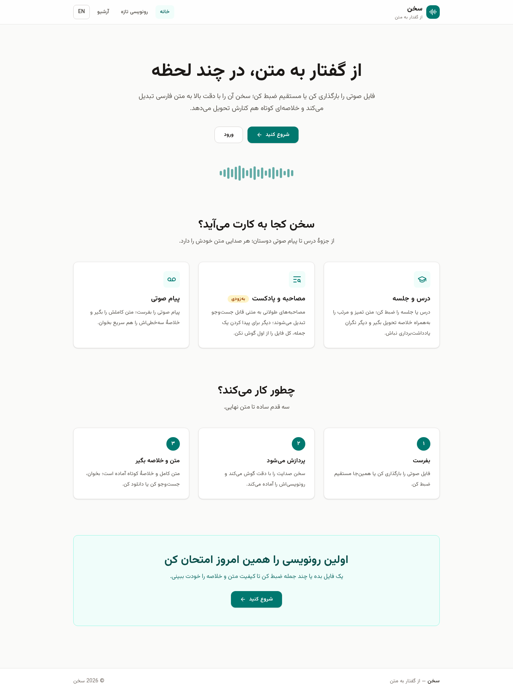
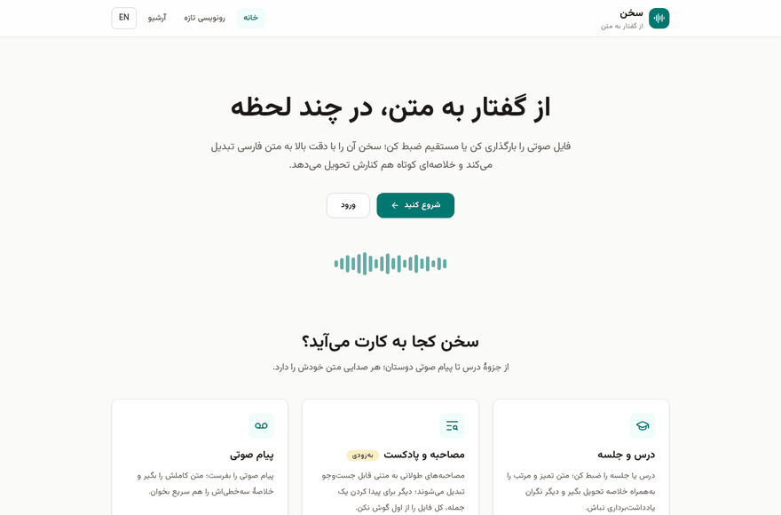
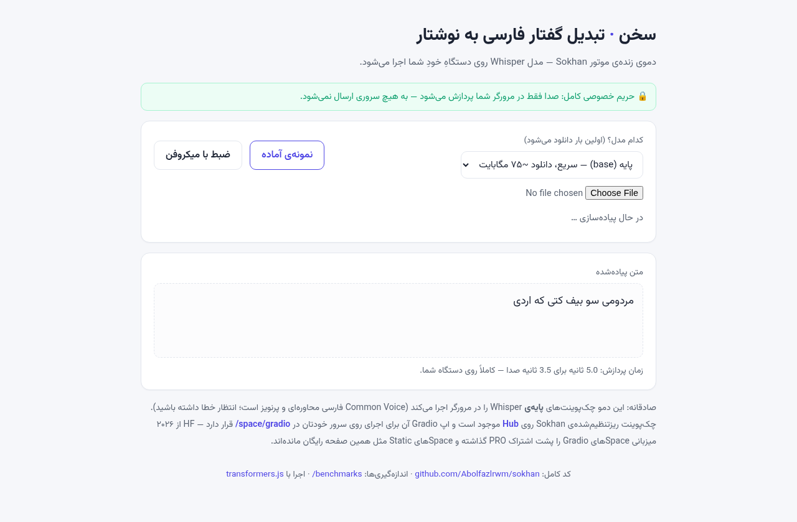
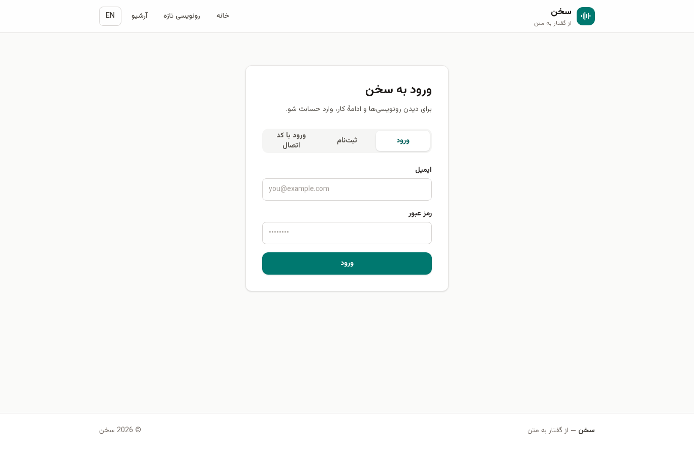
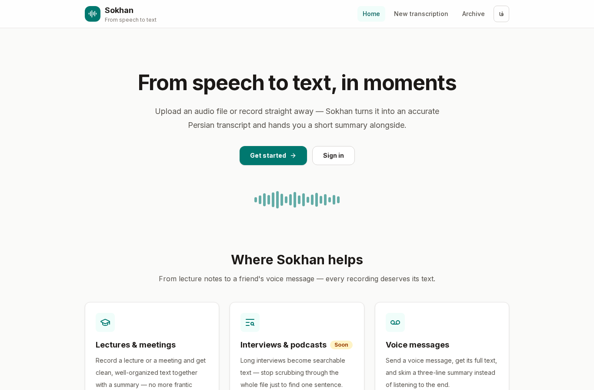

# Sokhan · سخن

**English** | [فارسی](README.fa.md)

<div align="center">
  
</div>

[](https://github.com/Abolfazlrwm/sokhan/actions/workflows/ci.yml)
[](https://github.com/Abolfazlrwm/sokhan/actions/workflows/codeql.yml)
[](https://github.com/Abolfazlrwm/sokhan/actions/workflows/docker.yml)
[](https://github.com/Abolfazlrwm/sokhan/actions/workflows/benchmark.yml)
[](https://github.com/Abolfazlrwm/sokhan/actions/workflows/sync-space.yml)
[](https://github.com/Abolfazlrwm/sokhan/releases)
[](https://api.securityscorecards.dev/projects/github.com/Abolfazlrwm/sokhan)
[](https://abolfazlrwm.github.io/sokhan/)
[](LICENSE)

**Persian-first speech-to-text toolkit.** Send a voice message — get back a transcript and a summary.

**Try it in the browser first:** the public demo at
[hf.co/spaces/Abol0pati/sokhan-fa-demo](https://huggingface.co/spaces/Abol0pati/sokhan-fa-demo)
runs Whisper entirely client-side (transformers.js, ONNX q8) — mic or file
upload, base/small selectable, nothing to install, nothing uploaded. The
**fine-tuned** checkpoint ships as a self-hostable Gradio app
([space/gradio/](space/gradio/)); HF's 2026 pricing gates hosted Gradio
Spaces behind PRO, so the free Space is the static page. A one-page
**landing site** with the measured numbers lives at
[abolfazlrwm.github.io/sokhan](https://abolfazlrwm.github.io/sokhan/)
(auto-deployed from [`site/`](site/)).

Sokhan runs entirely on your own hardware: a FastAPI service with a
faster-whisper engine, a Celery worker, a Next.js dashboard written
Persian-first (RTL), and an optional Telegram bot. No cloud account, no
per-minute pricing. Source-available: free for noncommercial use,
paid license for commercial use (see [License](#license)).



Real end-to-end run — upload a Persian voice clip, watch the live progress,
get the transcript (recorded against the actual app, no mockups):



The same Space demo, after transcribing a real Common Voice (fa) clip in a
headless browser (3.5 s clip, 5.0 s on-device):



If Sokhan is useful to you, the star button helps other Persian speakers
find it.

## Why

Most speech-to-text tooling treats Persian as an afterthought. Sokhan is
built for Persian speakers from the first commit:

- Persian UI first, English as a secondary locale (RTL by default)
- Archive search normalizes Arabic look-alikes (ي→ی, ك→ک) so text typed on
  any keyboard layout matches
- LLM summaries are prompted in Persian
- Everything is self-hostable with one `docker compose` command

## Who it is for

- **Students** — record a lecture, get clean text plus a summary
- **Journalists and podcasters** — turn long interviews into searchable text
- **Everyone** — send a long voice message, get the text and a short summary

## Features

- **Transcription engine** — audio streams off disk block-by-block with PyAV
  (no external ffmpeg; `STREAMING_DECODE`, default on), is split into
  30-second windows with a 1-second overlap, transcribed with faster-whisper
  on CPU (int8), and merged: boundary duplicates are dropped, timestamps are
  clamped to the file duration. Peak RAM stays flat as recordings grow —
  measured 86.4 MB vs 355.6 MB for a 30-minute file (4.1× lower)
- **Persian punctuation restoration** — a deterministic rule-based post-pass
  (v1.4) turns the raw Whisper word stream into publishable text: Persian
  question marks on question sentences, sentence periods, Latin marks mapped
  to ،/؛/؟, spacing fixed around every mark, decimals and clock times left
  intact (`PUNCTUATION_ENABLED`, on by default)
- **Exports** — TXT, SRT, WebVTT (all with accurate timecodes), structured
  JSON and DOCX; the dashboard also shows the per-segment timeline with
  speaker labels and a copy-to-clipboard button
- **Confidence-aware review flags** — every segment carries the model's own
  `exp(avg_logprob)` confidence; spans below `LOW_CONFIDENCE_THRESHOLD` are
  marked `⚠` in SRT/VTT/DOCX exports and badge "needs review" in the
  dashboard timeline, so human reviewers know exactly where to re-listen
- **OpenAI-compatible API** — `POST /v1/audio/transcriptions` works with the
  same multipart contract as the OpenAI API (`json`, `text`, `srt`, `vtt`,
  `verbose_json`), so existing tooling can point at your own instance
- **Signed webhooks** — pass `callback_url` when creating a job and the
  worker POSTs a completion/failure event to it, HMAC-signed
  (`X-Sokhan-Signature: t=…,v1=…`) so receivers verify the origin; one retry,
  and a dead endpoint never flips the job's status
- **Job pipeline** — upload, progress polling, transcript downloads; Celery +
  Redis in production, inline threads (`CELERY_ENABLED=false`) when you don't
  want Redis at all
- **Plans & quotas** — two tiers out of the box: **Free** (10-minute files,
  30 minutes/month) and **Pro** (180-minute files, 1,200 minutes/month,
  active while the subscription is unexpired). Both upload paths (`POST
  /jobs` and `POST /v1/audio/transcriptions`) reject over-limit work with an
  honest HTTP 402 (`quota_exceeded` / `file_too_long`), expired subscribers
  fall back to free limits automatically, and the operator grants time-boxed
  subscriptions via `POST /admin/users/{email}/plan` (renewals stack)
- **Quota accounting** — per-user usage rows drive the monthly allowance;
  limits are operator-tunable through `PLAN_*` environment variables
- **Archive search** — Persian-normalized full-text search over transcripts
  and filenames (pg_trgm on Postgres, ILIKE elsewhere)
- **Web dashboard** — landing, login/registration + connect-code entry,
  upload with in-browser recording, live progress, searchable archive
- **Telegram bot** — send a voice message, receive the transcript; `/quota`,
  `/upgrade` (plan catalogue), `/track`, summary button, and a connect code
  that links your web account; voices longer than the plan's per-file cap
  are refused before upload with a Persian explanation
- **Summaries (optional)** — any OpenAI-compatible LLM endpoint behind
  `SUMMARY_ENABLED`; without a key everything else keeps working
- **Speaker diarization (optional)** — `DIARIZATION_ENGINE=stub|energy|pyannote`:
  a dependency-free energy heuristic for CPU-only hosts, or real neural
  diarization via pyannote; speaker labels flow into segments and the SRT
  export (see [ADR 0004](docs/adr/0004-diarization-engines.md))
- **Fine-tuning kit** — LoRA pipeline to adapt Whisper to Persian speech and
  serve the result with faster-whisper; verified end-to-end without a GPU
  ([training/](training/README.md)), one-click on free GPUs via
  [docs/free-gpu.md](docs/free-gpu.md)

## Screenshots

Login, registration and connect-code entry (Persian):



The same dashboard in the English locale:



## Quickstart (self-hosting)

Prerequisites: Docker with the compose plugin. Whisper runs on CPU by
default — a GPU is not required.

```bash
git clone https://github.com/Abolfazlrwm/sokhan.git
cd sokhan
cp .env.example deploy/.env   # compose reads the .env next to the compose file
# edit deploy/.env and set POSTGRES_PASSWORD to a long random value
docker compose -f deploy/docker-compose.yml up -d --build
```

- Web dashboard: http://localhost:3000
- API and docs: http://localhost:8000/docs

The worker downloads the configured Whisper model on first transcription
(`WHISPER_MODEL_SIZE`, default `small`) and caches it on the `sokhan-data`
volume (`HF_HOME=/data/huggingface`), so recreating the containers does not
download it again. To enable summaries, set
`SUMMARY_ENABLED=true` and your LLM variables in a `.env` file next to
`docker-compose.yml`. To apply schema migrations manually:

```bash
docker compose -f deploy/docker-compose.yml run --rm api \
  alembic -c /app/alembic.ini upgrade head
```

(The API also creates tables on startup; Alembic is there for upgrades.)

### Prebuilt images (skip the build)

Every push to `main` and every tagged release publishes images to GHCR via
the `docker.yml` workflow, so self-hosting does not have to compile
anything:

```bash
docker pull ghcr.io/abolfazlrwm/sokhan-api:latest
docker pull ghcr.io/abolfazlrwm/sokhan-web:latest
```

`deploy/docker-compose.yml` references the same image names next to its
`build:` blocks: keep `up -d --build` to build locally, or
`docker compose -f deploy/docker-compose.yml pull` and
`up -d --no-build` to run the published images. Pinned versions follow the
git tags (e.g. `ghcr.io/abolfazlrwm/sokhan-api:1.2.0`). Note the web image
bakes `NEXT_PUBLIC_API_BASE` (default `http://localhost:8000`) at build
time — deployments serving the dashboard from another origin pass the
build argument themselves.

## Development

```bash
# Backend (Python 3.10+, no GPU needed for the test suite)
pip install -e "backend[dev]" -e "bot[dev]"
pytest -m "not gpu_optional"          # fast tests; the fake engine is used
ruff check backend bot
mypy --config-file backend/pyproject.toml backend/sokhan

# Web (Node 20+)
cd web && npm install && npm run build

# Validate the compose file
docker compose -f deploy/docker-compose.yml config -q
```

Run a real-model transcription locally (needs network + espeak-ng):

```bash
SOKHAN_REAL_MODEL_TEST=1 pytest backend/tests/test_real_model.py
```

### Configuration

| Variable | Default | Description |
| --- | --- | --- |
| `DATABASE_URL` | `sqlite:///./sokhan-dev.sqlite3` | Postgres in production |
| `REDIS_URL` | `redis://localhost:6379/0` | Celery broker/backend |
| `CELERY_ENABLED` | `true` | `false` runs jobs inline (no Redis) |
| `DATA_DIR` | `./data` | Uploaded audio storage |
| `WHISPER_MODEL_SIZE` | `small` | tiny/base/small/medium/large-v3 |
| `WHISPER_DEVICE` | `cpu` | or `cuda` |
| `WHISPER_COMPUTE_TYPE` | `int8` | `float16` on GPU |
| `FREE_MINUTES_PER_USER_PER_MONTH` | `30` | per-user monthly allowance of the free plan |
| `PLAN_FREE_MAX_FILE_MINUTES` | `10` | per-file duration cap of the free plan |
| `PLAN_PRO_MAX_FILE_MINUTES` | `180` | per-file cap for active pro subscribers |
| `PLAN_PRO_MONTHLY_MINUTES` | `1200` | monthly allowance for active pro subscribers |
| `ADMIN_API_KEY` | empty | shared secret for `POST /admin/users/{email}/plan`; empty disables the admin surface |
| `MAX_UPLOAD_MB` | `200` | upload size limit |
| `PUNCTUATION_ENABLED` | `true` | rule-based Persian punctuation post-pass |
| `LOW_CONFIDENCE_THRESHOLD` | `0.5` | segment confidence below which review flags apply |
| `STREAMING_DECODE` | `true` | decode audio block-by-block (peak RAM ∝ window, not file length) |
| `WEBHOOK_SIGNING_SECRET` | empty | HMAC secret for job-completion callbacks (`X-Sokhan-Signature`); empty sends them unsigned |
| `SUMMARY_ENABLED` | `false` | LLM summaries feature flag |
| `LLM_API_BASE` / `LLM_API_KEY` / `LLM_MODEL` | empty | OpenAI-compatible endpoint |
| `TELEGRAM_BOT_TOKEN` | empty | enables the bot process |
| `WEB_BASE_URL` | `http://localhost:3000` | links the bot sends |
| `API_BASE_URL` | `http://localhost:8000` | API address the bot calls |
| `NEXT_PUBLIC_API_BASE` | `http://localhost:8000` | API address the web app calls (build-time) |

See [.env.example](.env.example) for the commented list.

## API surface

| Endpoint | Purpose |
| --- | --- |
| `POST /auth/register`, `POST /auth/login` | email accounts |
| `POST /auth/token-login`, `POST /auth/telegram` | connect codes / bot linking |
| `POST /jobs` | upload audio (`language`, `want_summary`, optional `callback_url`), returns a queued job |
| `GET /jobs` / `GET /jobs/{id}` | list, and detail with progress + segments |
| `GET /jobs/{id}/transcript?format=txt\|srt\|vtt\|json\|docx` | exports |
| `GET /jobs/{id}/summary` | LLM summary when enabled |
| `GET /search?q=…` | Persian-normalized archive search |
| `GET /quota` | plan, monthly usage and per-file cap |
| `GET /plans` | public plan catalogue (free / pro limits) |
| `GET /admin/users/{email}` | operator: inspect a user's plan and expiry |
| `POST /admin/users/{email}/plan` | operator: grant pro for N days (renewals stack) or revert to free; `X-Admin-Key` required |
| `POST /v1/audio/transcriptions` | OpenAI-compatible transcription |

## Repository layout

```
backend/     FastAPI service, Whisper engine, worker pipeline, Alembic
web/         Next.js dashboard (fa/en, RTL-first)
bot/         aiogram 3 Telegram bot
benchmarks/  reproducible WER benchmark on real Common Voice (fa) clips
training/    Persian Whisper fine-tuning pipeline (LoRA, month-two roadmap)
deploy/      docker-compose for one-command self-hosting
docs/        architecture notes and decision records (ADRs)
site/        the GitHub Pages landing page (auto-deployed)
```

## Data and privacy

A speech-to-text product handles recordings, so the privacy story is
explicit instead of implied:

- **Self-hosted = your machine.** Audio lands in `DATA_DIR` on the server
  you run, transcripts and usage rows live in your own Postgres, and
  deleting a job deletes its file — nothing is replicated, phoned home,
  or shared with a third-party service. Whisper runs locally; no cloud
  API is involved anywhere in the transcription path.
- **The browser demo uploads nothing.** The public Space runs
  transformers.js (ONNX, q8) inside the visitor's browser: both the model
  weights and the audio stay on the visitor's device. The only network
  traffic is downloading the public model from the Hugging Face Hub.
- **No telemetry.** The backend ships with zero analytics, zero tracking,
  and no outbound calls except optional features you configure yourself
  (the LLM summary endpoint, if you enable it).
- **Operator retention is your decision.** Set your own policy for
  pruning `DATA_DIR` and old jobs; the schema keeps no copy of the audio
  anywhere else.

## Project status and honest limits

- Accuracy: measured on a fixed public sample — 12 real Common Voice (fa)
  clips, 61 s of audio, human-verified references. The v2 accuracy stack
  (Persian orthography initial prompt + `fa_polish` post-processing, both
  measured in [benchmarks/](benchmarks/README.md)) lifts the fixture from
  **WER 80.5% → 75.0% on `small`**, and the new **default engine is
  `medium`: WER 56.2% / CER 18.5%** at ~1.1x realtime on 2 CPU cores
  (int8, ~800 MB download; set `WHISPER_MODEL_SIZE=small` for the
  speed-first profile). The first GPU fine-tune — LoRA on `whisper-small`,
  500 clips, free Colab T4 — measures **WER 75.0% / CER 31.0%** under the
  same v2 harness
  ([Abol0pati/whisper-small-fa-sokhan](https://huggingface.co/Abol0pati/whisper-small-fa-sokhan)).
  These numbers are still high because Common Voice fa is colloquial and
  noisy; read speech is far easier. Full methodology and per-clip output:
  [benchmarks/README.md](benchmarks/README.md).
- Speaker labels depend on the diarization engine you pick. `energy` is a
  heuristic: its labels describe acoustic similarity, not verified identity,
  and it struggles beyond two speakers. `pyannote` is the real thing but
  needs the gated HF weights plus a token (see
  [ADR 0004](docs/adr/0004-diarization-engines.md)). With `stub` — the
  default — segments carry no speaker labels.
- Memory is bounded by design: the worker streams audio block-by-block
  (`STREAMING_DECODE`, default on) instead of decoding whole files — a
  30-minute recording peaks at 86.4 MB vs 355.6 MB fully decoded (measured
  on identical WAVs). Diarization engines that need the whole signal
  (`energy`, `pyannote`) still take the legacy full-decode path.

## Roadmap

- ~~Real speaker diarization behind an environment flag~~ — shipped in v1.1.0
  (`DIARIZATION_ENGINE=energy|pyannote`, see ADR 0004)
- Persian Whisper fine-tune — the first **GPU-scale** run is measured and
  published (v1.2.0): fixture WER 80.5% → 79.3% with only 500 training
  clips ([training/](training/README.md)); next step is the same notebook
  at `MAX_SAMPLES = 0` (full 10-hour manifest, ~2 h on a free T4,
  [docs/free-gpu.md](docs/free-gpu.md))
- ~~Streaming chunk decode to cut worker memory for long recordings~~ —
  shipped in v1.3.0 (`STREAMING_DECODE`, default on): peak RAM is bounded
  for multi-hour recordings, measured 4.1× lower on a 30-minute file
- ~~Persian punctuation restoration post-pass~~ — shipped: a deterministic
  rule-based pass (`PUNCTUATION_ENABLED`), no LLM dependency; segments also
  carry the model's confidence with review flags in exports and the dashboard
- ~~Webhooks/notifications when a job finishes~~ — shipped: the Telegram bot
  completion notifier (persisted across restarts) and signed HTTP webhooks
  for external callers (`callback_url` on `POST /jobs`,
  `X-Sokhan-Signature`), both in v1.3.0

Full versioned roadmap with acceptance criteria (and the measurement-first
rule everything is held to): [docs/ROADMAP.md](docs/ROADMAP.md).

## License

Sokhan is source-available under the [PolyForm Noncommercial 1.0.0](https://polyformproject.org/licenses/noncommercial/1.0.0)
license (see [LICENSE](LICENSE)): reading, reviewing and evaluating the code
is free, and **noncommercial use** (personal projects, study, research,
nonprofits) is free. **Any commercial use** — deploying it for a business,
building client projects on it, reselling it, or hosting it as a service —
requires a paid license from the author:
[Abolfazl Ranjbaran](https://github.com/Abolfazlrwm).

Releases up to and including v1.4.1 (2026-11-26) were published under the
MIT License and remain under it.
